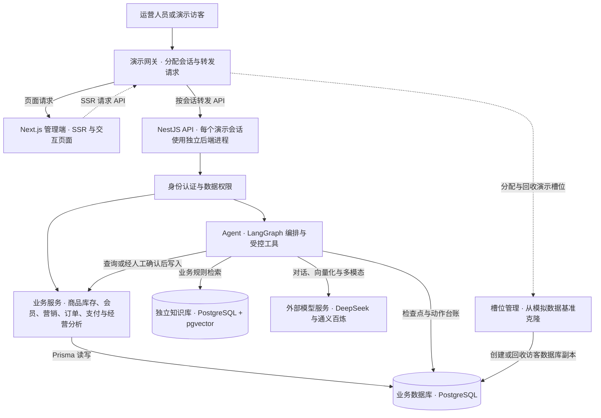
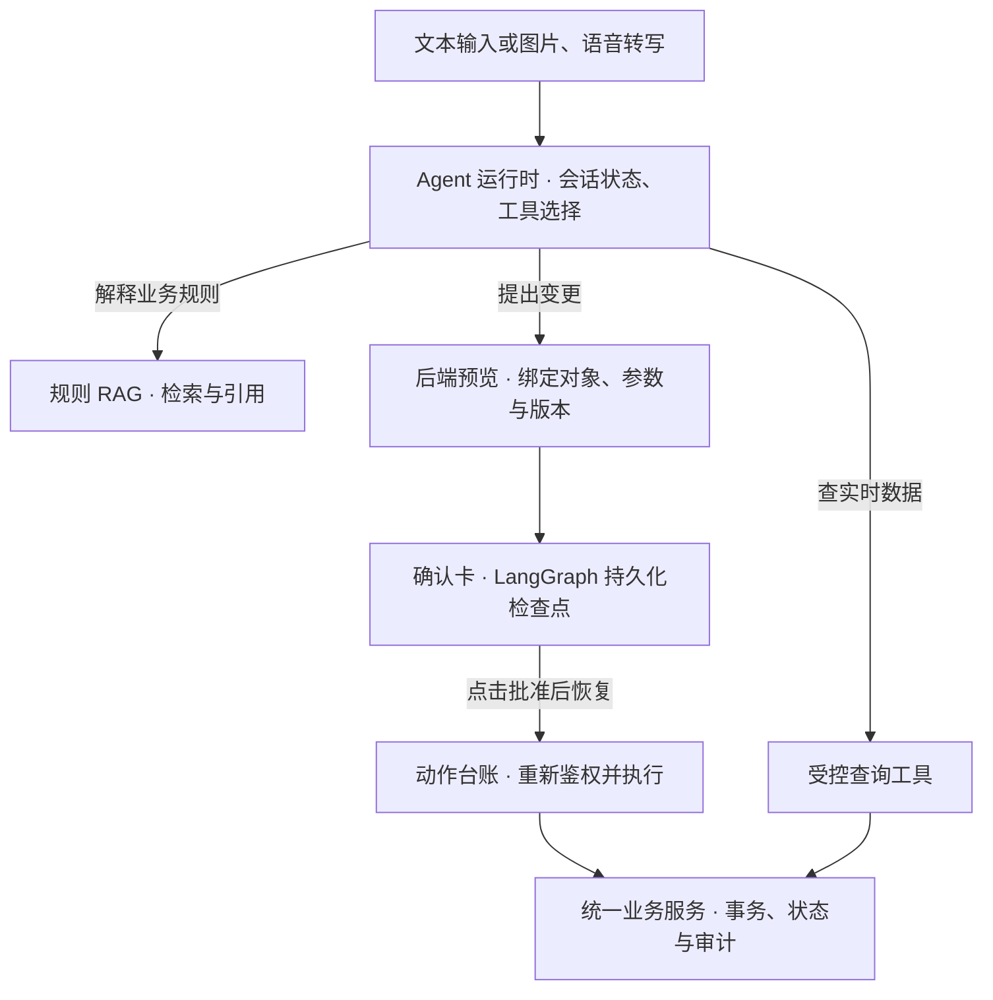

# Commerce Assistant · 电商运营管理与智能助手

面向零售电商运营的全栈项目，由两条主线组成。

- **传统电商**覆盖商品与库存、会员权益、营销、订单、模拟支付退款和履约，重点解决交易一致性、并发占用与状态推进。
- **AI Agent**覆盖实时经营查询、业务规则检索、带人工确认的操作和可恢复的批量任务，重点解决模型输出如何转化为可验证、可审计的业务操作。

管理页面与 Agent 共用同一套服务端权限和业务规则。通过页面建单或由 Agent 代建单，库存、优惠资格、计价和订单状态的校验都由后端负责。

## 项目演示

[观看或下载项目介绍视频（2 分 59 秒）](./media/project-intro.mp4?raw=true)

视频展示了会员下单、模拟支付与履约，以及 Agent 查询和订单预览。

- **会员交易**：选择会员、门店和商品，查看报价并建单，完成模拟支付、发货和收货。
- **Agent 调价**：指定商品编号和新售价，核对确认卡，批准后刷新商品详情查看改价结果。
- **访客隔离**：用两个独立的浏览器会话打开演示。在一个会话修改价格，在另一个会话核对原价，再结束并重新开始第一个会话，确认原价已恢复。

**在线体验**目前待域名备案和 HTTPS 接入。

## 整体架构



云端由 Docker Compose 运行网关、管理端、两套演示 API 槽位和两个 PostgreSQL 实例。每个演示槽位绑定独立业务库，规则知识库供 Agent 检索。本地开发时，可以直接启动 Web 和 API，通过常规业务库体验管理功能。

## 功能概览

| 模块       | 已实现能力                                                             |
| ---------- | ---------------------------------------------------------------------- |
| 经营分析   | 经营指标、趋势、商品与门店排行，按日期和数据范围筛选                   |
| 商品与库存 | 商品、分类、上下架、回收站、库存调整、库存占用和流水                   |
| 会员与权益 | 会员档案、六档成长等级、人工等级覆盖、分段折扣、积分与权益审计         |
| 营销活动   | 满减券、单人和批量发券、发放记录、限时秒杀、新会员礼包、生日关怀       |
| 订单与履约 | 报价、待支付订单、取消、商品与优惠快照、模拟发货和收货                 |
| 支付与退款 | 模拟支付、整单退款、失败重试、重复通知幂等、支付退款记录               |
| 数据与权限 | CSV 导入、用户角色、菜单和按钮权限、区域与门店数据范围、操作日志       |
| AI Agent   | 自然语言查询、业务规则 RAG、人工确认卡、批量操作、图片输入、语音转文字 |

## 主线一 · 传统电商

### 交易架构

Next.js 管理端通过 NestJS API 访问商品库存、会员权益、营销、订单和支付等服务。以订单为主线，报价计算优惠与会员权益，建单占用库存和优惠资格，支付确认完成核销与权益结算，后续再推进模拟发货、收货或退款。

### 核心难点与设计

| 难点 | 实现 |
| --- | --- |
| 报价与建单之间数据可能变化 | 报价只读。建单按当时的库存、优惠资格和限购重新校验，在事务中写入待支付订单并占用对应资源。 |
| 并发下单可能争抢同一份库存或优惠 | 建单使用可串行化事务，库存和优惠占用结合状态条件更新。待支付订单取消时释放占用。 |
| 支付、退款可能重复通知 | 通过状态校验和幂等处理推进订单与支付状态，重复通知复用已有结果。支付和退款使用模拟渠道。 |
| 商品和会员规则会随运营调整 | 订单保存成交时的商品、价格、优惠与会员计价快照，历史订单按原成交口径查看。 |
| 同一个后台服务不同范围的操作员 | 服务端同时校验操作权限与区域、门店数据范围，页面和 Agent 共用这套约束。 |

**演示路径**：用会员优惠为一笔订单报价并建单，查看待支付订单和库存占用。取消一单观察资源释放，再模拟支付另一单查看优惠核销、权益记录和履约状态变化。

源码入口：[订单服务](apps/api/src/orders/orders.service.ts) · [库存占用](apps/api/src/orders/product-stock.ts) · [交易集成测试](apps/api/test/run-member-business.cjs)

## 主线二 · AI Agent

### 请求与执行架构



DeepSeek 负责对话和工具选择。百炼图片识别、语音转写将输入转换成文本，再走同一个会话入口。业务查询、规则解释和变更预览各有独立工具，工具声明随当前身份的权限和数据范围裁剪，执行时仍由后端校验。

### 核心难点与设计

| 难点 | 实现 |
| --- | --- |
| 模型可能误选对象或把描述当事实 | 通过结构化参数调用注册工具。实时数据取自业务查询，规则解释从 pgvector 检索已发布的规则版本并附来源。遇到同名会员先请用户选择，规则未命中时明确告知。 |
| 预览到批准之间，权限或数据可能变化 | 后端生成待确认动作，绑定目标、参数哈希和版本。用户点击确认卡后，重新验证身份、权限及业务状态。旧卡发生变化时要求重新预览。 |
| 中断或重复确认可能导致重复写入 | LangGraph 用 PostgreSQL 检查点记录等待确认及恢复位置。业务结果由动作台账记录，执行前按动作状态与版本领取执行权。对于建单等支持幂等的链路，恢复时沿用原请求标识。 |
| 批量操作会出现部分成功或结果不明 | 预览时固定目标集合和每项计划，执行时逐项存档。恢复同一批次会跳过已有明确结果的项目。执行结果不明时保留待核对状态，防止重复建单。 |
| 跨业务任务需要承接上一步的真实结果 | 将创建会员再建单、创建券模板再发券等任务拆成有依赖的步骤。上一步完成后从服务端状态读取真实业务 ID 再继续，每个写入步骤单独确认。 |

**演示路径**：要求 Agent 从已有会员中随机选人，为指定商品批量建单。先查看确认卡里的固定名单和报价，再点击批准，观察每项成功、失败或待核对状态。重复打开原确认卡并确认，可核对成功订单没有重复创建。

源码入口：[工具注册](apps/api/src/agent/capability-registry.ts) · [规则检索](apps/api/src/agent/knowledge/knowledge.service.ts) · [确认工作流](apps/api/src/agent/approval-workflow.ts) · [动作执行](apps/api/src/agent/actions.ts) · [批量建单](apps/api/src/agent/batch-orders.ts)

### 模型配置

| 用途             | 当前实现                                                            |
| ---------------- | ------------------------------------------------------------------- |
| 对话与工具调用   | DeepSeek，模型通过服务端环境变量配置                                |
| 规则检索向量     | 百炼 `qwen3.7-text-embedding-flash`，1024 维，PostgreSQL + pgvector |
| 图片与语音转换   | 百炼 `qwen3.8-omni-flash`                                           |

所有模型密钥仅由后端读取。未配置相应模型时，对应 Agent 能力不可用，不影响独立运行的管理业务。

## 技术栈

| 层次       | 技术                                                                         |
| ---------- | ---------------------------------------------------------------------------- |
| Web        | Next.js 16 App Router、React 19、TypeScript                                  |
| 界面与状态 | Tailwind CSS、Radix UI、Redux Toolkit、React Hook Form、Zod、Recharts        |
| API        | Node.js 24、NestJS 11、Prisma 6                                              |
| 数据       | PostgreSQL 17、pgvector                                                      |
| AI 编排    | LangChain、LangGraph、受控业务工具与 RAG                                     |
| 测试       | Jest、Vitest、Testing Library、隔离数据库 HTTP 集成测试、Node.js Test Runner |
| 工程管理   | pnpm workspace、Docker Compose                                              |

Next.js 负责页面和渲染；NestJS 是统一业务 API。业务数据库与规则知识库分别部署，业务写入不会通过向量检索绕过原有服务。

## 独立演示与自动恢复

云端演示模式为每次浏览器体验分配独立业务数据库和后端进程：

- 每位访客从预设模拟数据开始，修改仅影响自己的副本。
- 同时最多两位访客；名额满时提示稍后重试，不共享正在使用的数据。
- 主动结束或空闲 30 分钟后回收；每次体验最长 4 小时，执行中的请求完成前不回收。
- 回收时先终止旧后端，下一位进入前重新克隆基准数据；旧会话凭据失效。
- 新会话按当前日期平移模拟业务时间戳，保留生日、金额与成交快照。
- 同一浏览器配置中的多个标签页共享一次体验；服务重启后需重新开始。

该模式包含会话生命周期测试，以及 PostgreSQL 的克隆、隔离和恢复测试。腾讯云实机已通过模拟数据恢复、双访客隔离、名额回收、旧 Cookie 失效及真实 Agent 确认测试。目前服务仅在云机本地监听，公网域名和 HTTPS 待接入。

## 目录结构

以下是公开版源码的目录。

```text
apps/
  api/
    prisma/                 数据模型与增量迁移
    src/auth/               登录、权限与数据范围
    src/members/            会员档案
    src/member-benefits/    成长、折扣、积分与权益
    src/orders/             报价、订单、库存与履约
    src/coupons/            优惠券与发券
    src/marketing/          新人、生日等营销规则
    src/payments/           模拟支付与退款
    src/seckill/            限时秒杀
    src/agent/              Agent、受控工具、确认流程与规则检索
    scripts/                模拟数据生成与规则摄入
  web/
    app/                    页面路由、布局与服务端渲染
    src/components/         界面与 Agent 交互组件
    src/views/              业务页面
    src/lib/                API 与业务辅助逻辑
    src/store/              登录与全局状态
infra/                      本地基础服务与独立知识库配置
samples/                    CSV 与商品样例
media/                      项目介绍视频
```

## 本地运行

环境：Node.js 24、pnpm 11.20.0、Docker。以下使用 Bash；Windows 可在 Git Bash 中执行。

### 1. 安装与配置

克隆仓库并安装依赖：

```bash
git clone https://github.com/MMMMMrClown/commerce-assistant-showcase.git
cd commerce-assistant-showcase
corepack enable
corepack prepare pnpm@11.20.0 --activate
pnpm install --frozen-lockfile
```

首次克隆时，复制配置模板并按实际环境填写。已有配置或数据库时保留原文件，跳过对应初始化步骤。

```bash
cp infra/.env.example infra/.env
cp apps/api/.env.example apps/api/.env
cp apps/web/.env.example apps/web/.env.local

docker compose --env-file infra/.env -f infra/compose.yaml up -d postgres
pnpm db:generate
pnpm --filter api build
```

确认 `apps/api/.env` 的 `DATABASE_URL` 与本地 PostgreSQL 用户、密码、端口和数据库一致。模板使用本机 `55432` 端口；容器内端口为 `5432`。

### 2. 准备业务数据

- **复用已有数据库或备份**：连接正确的数据库后，通过 `pnpm --filter api exec prisma migrate deploy` 应用增量迁移，保留已有演示数据。
- **创建一套全新模拟数据**：执行下面的独立脚本，它会新建演示数据库，输出库名与体验账号。随后将 `DATABASE_URL` 的数据库名改为该输出值；脚本不会自动切换当前服务。

```bash
cd apps/api
node scripts/demo-retail-data.cjs --create
cd ../..
```

演示数据与知识库备份不包含在源码中。`pnpm db:seed` 属于早期初始化入口，不要对已有数据使用它。

### 3. 启动项目

```bash
pnpm dev
```

| 入口    | 地址                             |
| ------- | -------------------------------- |
| Web     | `http://localhost:5173`          |
| API     | `http://localhost:3200/api/v1`   |
| Swagger | `http://localhost:3200/api/docs` |

登录账号以导入的数据或模拟数据脚本输出为准。云端独立演示的账号与密码显示在体验入口，可能与本机不同。

### 4. 启用 Agent

**公开版保留了 Agent 模型接入代码，仅提供配置模板，未附带任何模型 API Key。** 配置模板为 [apps/api/.env.example](apps/api/.env.example)，各模型 Key 默认为空。商品、会员和订单等后台功能可独立运行。需要调用真实模型时，在本机的 `apps/api/.env` 填写自己的 Key，并重启 API。

| 变量                                             | 作用                         |
| ------------------------------------------------ | ---------------------------- |
| `AGENT_BASE_URL`、`AGENT_MODEL`、`AGENT_API_KEY` | 对话模型与工具调用           |
| `KNOWLEDGE_DATABASE_URL`                         | 独立 pgvector 知识库         |
| `AGENT_EMBEDDING_URL`、`AGENT_EMBEDDING_API_KEY` | 规则向量化与检索             |
| `AGENT_MEDIA_URL`、`AGENT_MEDIA_API_KEY`         | 图片与语音输入转换           |
| `AGENT_WRITES_ENABLED`                           | 是否允许生成并执行受控写操作 |
| `MOCK_PAYMENTS_ENABLED`                          | 是否开启模拟支付与退款       |

只体验 Agent 对话和业务工具时，先配置对话模型即可。体验规则检索时，再启动独立知识库：

```bash
mkdir -p .local-dev
cp infra/agent-knowledge.env.example .local-dev/agent-knowledge.env
```

填写 `.local-dev/agent-knowledge.env` 的数据库密码，并将 `apps/api/.env` 的 `KNOWLEDGE_DATABASE_URL` 配置为对应连接地址。之后启动容器并导入规则。

```bash
docker compose --env-file .local-dev/agent-knowledge.env -f infra/agent-knowledge.compose.yaml up -d
pnpm --filter api agent:knowledge:ingest
```

## 当前边界

- 支付、退款和发货收货用于模拟演示，未对接真实资金渠道与物流服务。
- 当前提供运营管理端，uni-app 顾客端尚未实现。
- Agent 仅覆盖已注册的工具，部分业务仍需在管理页面操作。
- Redis、MinIO 保留基础设施配置，当前核心业务和云端演示不依赖它们。
