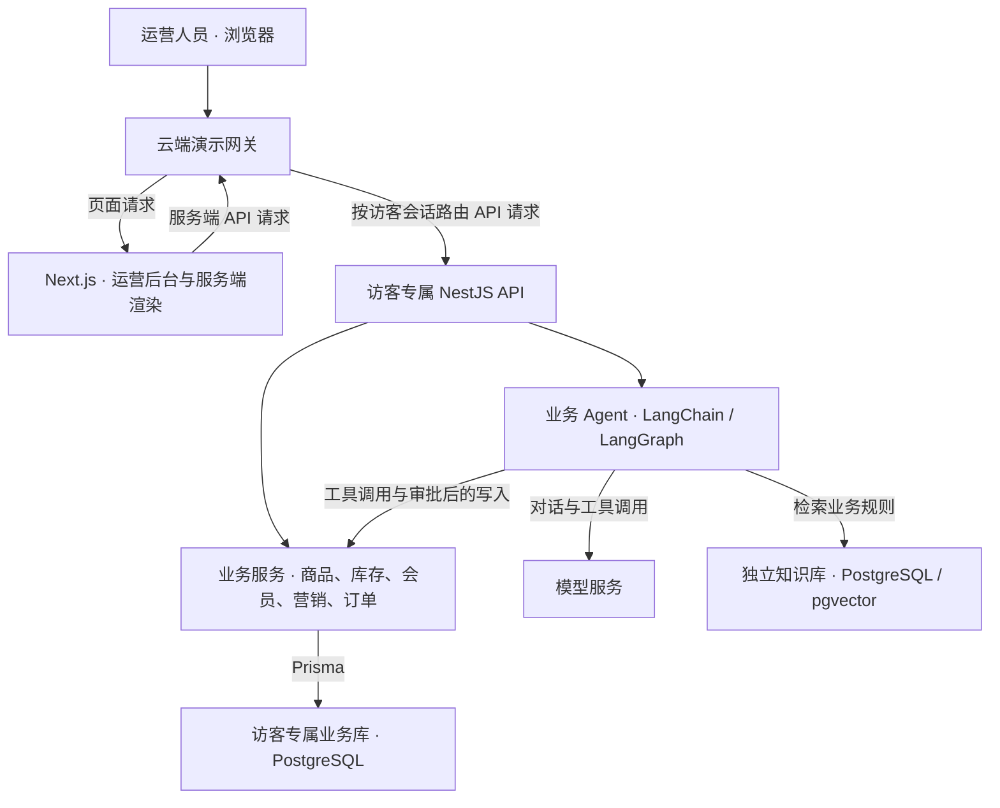

# Commerce Assistant · 电商运营管理与智能助手

面向零售电商运营场景的全栈项目，将商品、会员、营销、订单、模拟支付退款和经营分析整合在同一个管理端，并内嵌能够查询业务、检索规则、生成操作方案和执行受控业务动作的 AI Agent。

项目重点是让管理页面、业务规则和 Agent 使用同一套后端能力：页面操作与 Agent 操作遵守相同的权限、库存、计价和订单状态约束。

## 项目演示

[观看或下载项目介绍视频（2 分 59 秒）](./media/project-intro.mp4?raw=true)

视频展示了会员下单、模拟支付与履约，以及 Agent 查询和订单预览。

- **会员交易**：选择会员、门店和商品，查看报价并建单，完成模拟支付、发货和收货。
- **Agent 调价**：指定商品编号和新售价，核对确认卡，批准后刷新商品详情查看改价结果。
- **访客隔离**：用两个独立的浏览器会话打开演示。在一个会话修改价格，在另一个会话核对原价，再结束并重新开始第一个会话，确认原价已恢复。

**在线体验**目前待域名备案和 HTTPS 接入。

## 项目总体架构



Next.js 负责页面交互和渲染，NestJS 统一处理鉴权、业务校验和数据访问。管理页面与 Agent 复用同一套业务服务。Agent 查询时可以检索规则，涉及写入时先生成确认卡，批准后再由业务服务执行。

云端演示共用 Web 前端和规则知识库。网关按会话分配两套独立的后端进程与业务数据库，回收名额后从基准数据恢复。

## 功能概览

| 模块       | 已实现能力                                                             |
| ---------- | ---------------------------------------------------------------------- |
| 经营分析   | 经营指标、趋势、商品与门店排行，按日期和数据范围筛选                   |
| 商品与库存 | 商品、分类、上下架、回收站、库存调整、库存占用和流水                   |
| 会员与权益 | 会员档案、六档成长等级、人工等级覆盖、分段折扣、积分与权益审计         |
| 营销活动   | 满减券、单人和批量发券、发放记录、限时秒杀、新会员礼包、生日关怀       |
| 订单与履约 | 报价、待支付订单、取消、商品与优惠快照、模拟发货和收货                 |
| 支付与退款 | 模拟支付、整单退款、失败重试、重复通知幂等、支付退款记录               |
| 数据与权限 | CSV 导入、用户角色、菜单和按钮权限、区域与门店数据范围、操作日志       |
| AI Agent   | 自然语言查询、业务规则 RAG、人工确认卡、批量操作、图片输入、语音转文字 |

## 核心业务设计

- **交易闭环**：报价只读；建单时校验并占用库存和优惠资格，支付成功后再处理核销、积分和成长权益。
- **一致性与幂等**：订单状态、库存、优惠券和会员流水通过事务与状态校验关联；支付通知和 Agent 重复批准复用已有结果。
- **历史快照**：订单保留成交时的商品、价格、优惠与会员计价信息，避免后续资料修改影响历史订单。
- **权限落在服务端**：角色权限与区域、门店数据范围同时约束查询和写入，前端隐藏按钮不代替接口鉴权。
- **受控批量操作**：冻结目标对象和预览结果后统一确认，逐项记录成功、失败和待核对状态，不将部分成功描述成全部成功。

## Agent 如何参与业务

查询类请求可以直接返回有权限查看的业务结果；修改类请求先形成待确认方案，经用户批准后，由原有业务 Service 执行。

```text
自然语言 / 图片识别文本 / 语音识别文本
                  ↓
          意图识别与受控工具调用
                  ↓
       业务查询 / 规则检索 / 操作预览
                  ↓
       修改类操作 → 人工确认 → 原业务服务
                  ↓
          事务处理、结果记录与审计
```

当前支持会员与订单查询、商品信息维护、营销与交易操作及批量编排等已接入工具。Agent 不接受任意 SQL 或任意请求地址；写入仍经过身份、权限、参数、版本和业务状态校验。图片与语音先转换为文本，再进入原有业务流程。

模型配置分为三部分：

| 用途             | 当前实现                                                            |
| ---------------- | ------------------------------------------------------------------- |
| 对话与工具调用   | DeepSeek，模型通过服务端环境变量配置                                |
| 规则检索向量     | 百炼 `qwen3.7-text-embedding-flash`，1024 维，PostgreSQL + pgvector |
| 图片与语音转换   | 百炼 `qwen3.8-omni-flash`                                           |
| 写操作确认与恢复 | LangGraph + PostgreSQL 检查点，结合业务动作台账                     |

所有模型密钥仅由后端读取。未配置相应模型时，对应 Agent 能力不可用，不影响独立运行的管理业务。

## 技术栈

| 层次       | 技术                                                                         |
| ---------- | ---------------------------------------------------------------------------- |
| Web        | Next.js 16 App Router、React 19、TypeScript                                  |
| 界面与状态 | Tailwind CSS、Radix UI、Redux Toolkit、React Hook Form、Zod、Recharts        |
| API        | Node.js 24、NestJS 11、Prisma 6                                              |
| 数据       | PostgreSQL 17、pgvector                                                      |
| AI 编排    | LangChain、LangGraph、受控业务工具与 RAG                                     |
| 测试       | Jest、Vitest、Testing Library、隔离数据库 HTTP 集成测试、Node.js Test Runner |
| 工程管理   | pnpm workspace、Docker Compose                                              |

Next.js 负责页面和渲染；NestJS 是统一业务 API。业务数据库与规则知识库分别部署，业务写入不会通过向量检索绕过原有服务。

## 独立演示与自动恢复

云端演示模式为每次浏览器体验分配独立业务数据库和后端进程：

- 每位访客从预设模拟数据开始，修改仅影响自己的副本。
- 同时最多两位访客；名额满时提示稍后重试，不共享正在使用的数据。
- 主动结束或空闲 30 分钟后回收；每次体验最长 4 小时，执行中的请求完成前不回收。
- 回收时先终止旧后端，下一位进入前重新克隆基准数据；旧会话凭据失效。
- 新会话按当前日期平移模拟业务时间戳，保留生日、金额与成交快照。
- 同一浏览器配置中的多个标签页共享一次体验；服务重启后需重新开始。

该模式包含会话生命周期测试，以及 PostgreSQL 的克隆、隔离和恢复测试。腾讯云实机已通过模拟数据恢复、双访客隔离、名额回收、旧 Cookie 失效及真实 Agent 确认测试。目前服务仅在云机本地监听，公网域名和 HTTPS 待接入。

## 目录结构

以下是完整项目源码的目录。

```text
apps/
  api/
    prisma/                 数据模型与增量迁移
    src/auth/               登录、权限与数据范围
    src/members/            会员档案
    src/member-benefits/    成长、折扣、积分与权益
    src/orders/             报价、订单、库存与履约
    src/coupons/            优惠券与发券
    src/marketing/          新人、生日等营销规则
    src/payments/           模拟支付与退款
    src/seckill/            限时秒杀
    src/agent/              Agent、受控工具、确认流程与规则检索
    scripts/                演示数据、规则摄入与隔离验收
  web/
    app/                    页面路由、布局与服务端渲染
    src/components/         界面与 Agent 交互组件
    src/views/              业务页面
    src/lib/                API 与业务辅助逻辑
    src/store/              登录与全局状态
infra/                      本地基础服务与独立知识库配置
deploy/demo/                云端独立演示、恢复和验收
samples/                    CSV 与商品样例
docs/                       业务规则、交付记录与源码说明
```

## 本地运行

以下流程适用于已获取完整源码的读者。此展示仓库提供项目说明和演示视频。

环境：Node.js 24、pnpm 11.20.0、Docker。以下使用 Bash；Windows 可在 Git Bash 中执行。

### 1. 安装与配置

进入完整项目的根目录后执行：

```bash
corepack enable
corepack prepare pnpm@11.20.0 --activate
pnpm install --frozen-lockfile
```

首次克隆时，复制配置模板并按实际环境填写。已有配置或数据库时保留原文件，跳过对应初始化步骤。

```bash
cp infra/.env.example infra/.env
cp apps/api/.env.example apps/api/.env
cp apps/web/.env.example apps/web/.env.local

docker compose --env-file infra/.env -f infra/compose.yaml up -d postgres
pnpm db:generate
pnpm --filter api build
```

确认 `apps/api/.env` 的 `DATABASE_URL` 与本地 PostgreSQL 用户、密码、端口和数据库一致。模板使用本机 `55432` 端口；容器内端口为 `5432`。

### 2. 准备业务数据

- **复用已有数据库或备份**：连接正确的数据库后，通过 `pnpm --filter api exec prisma migrate deploy` 应用增量迁移，保留已有演示数据。
- **创建一套全新模拟数据**：执行下面的独立脚本，它会新建演示数据库，输出库名与体验账号。随后将 `DATABASE_URL` 的数据库名改为该输出值；脚本不会自动切换当前服务。

```bash
cd apps/api
node scripts/demo-retail-data.cjs --create
cd ../..
```

演示数据与知识库备份不包含在源码中。`pnpm db:seed` 属于早期初始化入口，不要对已有数据使用它。

### 3. 启动项目

```bash
pnpm dev
```

| 入口    | 地址                             |
| ------- | -------------------------------- |
| Web     | `http://localhost:5173`          |
| API     | `http://localhost:3200/api/v1`   |
| Swagger | `http://localhost:3200/api/docs` |

登录账号以导入的数据或模拟数据脚本输出为准。云端独立演示的账号与密码显示在体验入口，可能与本机不同。

### 4. 启用 Agent

在 `apps/api/.env` 配置：

| 变量                                             | 作用                         |
| ------------------------------------------------ | ---------------------------- |
| `AGENT_BASE_URL`、`AGENT_MODEL`、`AGENT_API_KEY` | 对话模型与工具调用           |
| `KNOWLEDGE_DATABASE_URL`                         | 独立 pgvector 知识库         |
| `AGENT_EMBEDDING_URL`、`AGENT_EMBEDDING_API_KEY` | 规则向量化与检索             |
| `AGENT_MEDIA_URL`、`AGENT_MEDIA_API_KEY`         | 图片与语音输入转换           |
| `AGENT_WRITES_ENABLED`                           | 是否允许生成并执行受控写操作 |
| `MOCK_PAYMENTS_ENABLED`                          | 是否开启模拟支付与退款       |

独立知识库配置见 `infra/agent-knowledge.compose.yaml`。启动并配置后，执行 `pnpm --filter api agent:knowledge:ingest` 摄入预设规则。当前实现不需要运行 Ollama。

## 当前边界

- 支付、退款和发货收货用于模拟演示，未对接真实资金渠道与物流服务。
- 当前提供运营管理端，uni-app 顾客端尚未实现。
- Agent 仅覆盖已注册的工具，部分业务仍需在管理页面操作。
- Redis、MinIO 保留基础设施配置，当前核心业务和云端演示不依赖它们。
