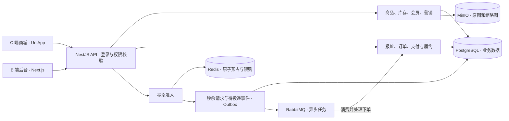
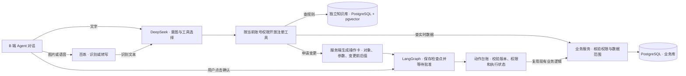

# 拾光集市 · B/C 电商与 AI 运营助手

拾光集市是一个全栈零售演示项目，包含 **C 端商城、B 端运营后台和嵌入后台的 AI Agent**。面试时可以用同一笔订单走完整个购买与履约流程，再用一张调价单演示 Agent 如何识图、查到准确的商品、生成确认卡，并在人工批准后执行。

| 项目亮点 | 实机可以看到什么 |
| --- | --- |
| **B/C 交易闭环** | C 端选券、下单、模拟钱包支付；B 端处理同一笔订单并发货；C 端确认收货 |
| **Agent 识图查数与受控执行** | 从调价单读出商品编号和新价格，查询当前售价，生成操作卡。确认后回查商品，并验证重复确认只返回同一次执行结果 |
| **可重复的云端演示** | 两位访客可以同时体验。每个访客的 B/C 两端共享各自的数据，改价或下单互不影响，结束后恢复到演示基准 |

**我负责的工作**涵盖产品取舍、关键流程与接口设计、AI 辅助开发、代码审查、双端联调和云端验收。我把演示目标落实成可复验的检查，例如对照 API 核对 Agent 查到的订单 ID 和状态，检查确认前后商品价格，以及验证一个访客的变更对另一个访客不可见。

## 架构一 · 传统电商

B/C 两端访问同一套服务和业务数据。消费者按身份访问自己的订单和券包，运营人员按角色及区域、门店数据范围操作。商品原图和缩略图分别服务于 C 端详情与 B 端列表。支付、退款和履约使用模拟流程。

### 交易线的难点与实现

| 难点 | 技术设计与取舍 |
| --- | --- |
| **报价之后价格、库存或优惠可能变化** | 结算先向服务端试算。建单时按当前条件重新校验，用可串行化事务写入订单并占用库存与券。取消待支付订单时释放占用。 |
| **重复点击或请求重试可能多建一单** | 下单请求用 `requestId` 识别同一次提交，并用请求摘要校验内容。相同请求可取回已有订单，同一标识携带不同内容会被拒绝。 |
| **支付重试与历史记录需要保持一致** | 模拟钱包扣款、钱包流水和订单支付状态由后端事务处理。订单保存成交时的商品、价格和优惠快照，后续改价仍可追溯原成交金额。 |
| **秒杀流量集中，不能把准入和正式成交混在一起** | Redis 原子预占活动名额并校验限购，服务端在同一笔数据库写入中保存请求和待投递事件（Outbox），后台再投递 RabbitMQ，避免请求已入库却因投递失败而丢失。C 端轮询结果，成功后进入待支付订单。业务订单仍由 PostgreSQL 保存。 |
| **单商城如何兼容连锁扩展** | C 端提供统一商城体验。B 端保留管理员、区域经理、店长和相应的数据范围，给后续连锁门店共用运营后台留出边界。 |

## 架构二 · AI Agent

### Agent 线的难点与实现

| 难点 | 技术设计与取舍 |
| --- | --- |
| **模型可能读错编号或选错对象** | 图片识别先抽取文字，模型构造查询，再由工具查真实商品、订单或会员。精确编号没查到时明确返回未找到。遇到同名对象可让用户选择。 |
| **实时数据与业务规则有不同来源** | 当前售价、订单状态、库存或余额走实时业务工具。领券、会员权益、审批等规则走 pgvector 检索，回答可引用来源章节与规则版本。 |
| **模型提出的修改需要可核对** | 后端根据真实业务对象生成操作卡，绑定目标、参数摘要和版本，展示变更内容。用户点击确认后，服务端重新检查身份、权限和业务状态。 |
| **等待确认期间会话可能中断，用户也可能重复点击** | LangGraph 的 PostgreSQL 检查点保存等待位置，确认后恢复流程。动作台账控制实际执行并记录结果。已完成的动作再次确认时复用原结果。 |
| **批量或跨业务操作可能部分成功** | 批量预览固定目标集合，执行逐项记录结果。多步任务读取前一步返回的真实业务 ID，再准备下一步的确认卡。恢复时跳过已完成步骤，结果不明的项目先核对。 |

**现场演示建议**。上传一张包含商品编号和目标售价的调价单。让 Agent 查当前售价并准备调价，展开卡片核对商品、旧价和新价。先验证商品还保持原价，再点击确认并刷新商品详情。这个过程能同时展示识别、实时查询、人工确认和业务回查。

## 演示入口

| 入口 | 内容 | 状态 |
| --- | --- | --- |
| C 端商城 | 商品浏览、领券、下单、模拟钱包支付、收货 | 域名接入并完成公网验收后补充地址 |
| B 端运营后台 | 卡片确认、订单发货、经营查询、商品与首页配置 | 域名接入并完成公网验收后补充地址 |
| 介绍录屏 | 早期交易、运营后台与 Agent 演示 | [观看或下载 2 分 59 秒录屏](./media/project-intro.mp4?raw=true) |

录屏来自早期版本。现行演示建议从 **C 端购买 → B 端查询同一订单并发货 → C 端收货 → B 端用调价单演示 Agent** 开始。同一浏览器会话打开 B/C 两个标签页可以查看同一份演示数据。

## 云端验证与演示隔离

| 验证范围 | 已核对的结果 |
| --- | --- |
| 云服务器内部业务入口 | B/C 联动、模拟支付与收货、异步秒杀、双访客互不影响及回收恢复 |
| 云端真实模型 | 商品照片识别、从调价单提取编号和小数价格、精确查询商品与订单、未知编号的处理、规则引用、调价确认及重复确认 |
| 公网演示 | 等待域名接入与最终演示数据核对，随后从公网入口复验 |

演示网关最多分配两个独立访客会话，每个会话从基准克隆一份业务数据库。访客可主动结束，空闲约 30 分钟会回收，单次最长 4 小时。名额复用前重建演示数据，旧会话凭据随之失效。

## 技术栈与仓库说明

| 层次 | 技术 |
| --- | --- |
| C 端与 B 端 | UniApp、Vue 3、Next.js、React、TypeScript |
| 业务服务 | NestJS、Prisma、PostgreSQL |
| 并发与媒体 | Redis、RabbitMQ、MinIO |
| Agent | DeepSeek、通义百炼、LangChain、LangGraph、pgvector |
| 发布 | Docker Compose、CNB、腾讯云 TCR 与 TAT |

本仓库用于项目展示，里面保留了早期公开源码。现行 B/C 演示版本通过独立发布仓库管理。
